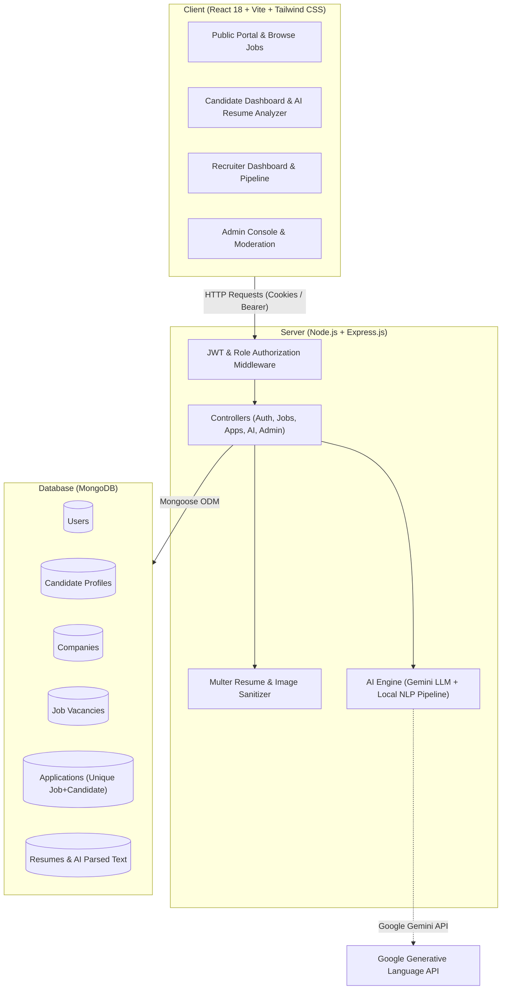

# AI Career Connect — Next-Gen AI-Powered Job Portal (MERN Stack)

[](https://reactjs.org/)
[](https://nodejs.org/)
[](https://www.mongodb.com/)
[](https://tailwindcss.com/)
[](https://ai.google.dev/)
[]()

> **AI Career Connect** is a complete, fully functional, production-ready Full-Stack MERN academic job portal that connects job seekers with hiring recruiters and enterprise employers. It features automated AI resume parsing, ATS scoring (out of 100), real-time resume-job compatibility scoring, intelligent job recommendations, an interactive 24/7 AI career coach, role-based authorization, and interactive data visualization dashboards.

---

## 📑 Table of Contents

- [1. Technology Stack](#1-technology-stack)
- [2. System Architecture](#2-system-architecture)
- [3. User Roles & Key Features](#3-user-roles--key-features)
- [4. AI Capabilities & Gemini Integration](#4-ai-capabilities--gemini-integration)
- [5. MongoDB Database Models](#5-mongodb-database-models)
- [6. REST API Endpoints Reference](#6-rest-api-endpoints-reference)
- [7. Security Implementation](#7-security-implementation)
- [8. Installation & Setup Guide](#8-installation--setup-guide)
- [9. Demo Credentials](#9-demo-credentials)
- [10. Running the Application](#10-running-the-application)
- [11. Running Automated Tests](#11-running-automated-tests)
- [12. Deployment Instructions](#12-deployment-instructions)

---

## 1. Technology Stack

### Frontend:
- **React.js 18** (Vite build engine)
- **Tailwind CSS 3** (Custom SaaS design palette: Navy Blue `#0B192C`, Purple `#7C3AED`, Accent `#2563EB`)
- **React Router DOM v6** (Nested routes, layout wrappers, role-based protected routes)
- **Axios** (Configured with credentials, baseURL `/api`, and auth interceptors)
- **Lucide React** (Clean, modern SVG iconography)
- **React Hot Toast** (Polished notifications for async operations)
- **Recharts** (Interactive recruitment funnel and candidate analytics)

### Backend:
- **Node.js (ES Modules)**
- **Express.js** (Robust REST API routing, rate limiting, and error handling)
- **Mongoose 8** (Schema modeling, compound unique indexing, and populate relations)
- **JSON Web Tokens (JWT)** (Secure authentication via HttpOnly cookies and Bearer tokens)
- **bcryptjs** (Salted password hashing with automated pre-save hooks)
- **Multer** (Validated multi-part file uploads for PDF/DOCX resumes and images)
- **pdf-parse** (Automated resume text extraction)
- **Helmet & CORS** (Production-grade security headers)

### Database:
- **MongoDB 8+ / MongoDB Atlas**
- Relational integrity via `ObjectId` references
- Duplicate application prevention via compound unique indices (`{ job: 1, candidate: 1 }`)

---

## 2. System Architecture



---

## 3. User Roles & Key Features

### A. Job Seeker
- **Authentication**: Registration and login with automated profile initialization.
- **Profile Management**: Full name, headline, bio, location, interactive skill chips, education, experience, expected salary, and portfolio links.
- **Resume Upload & AI Parsing**: Upload PDF/DOCX resumes with automated extraction into candidate skills.
- **Job Discovery & Search**: Keyword search across title, company, skills, location, workplace type (Remote/Hybrid/On-site), job type, and salary range.
- **One-Click Application**: Attach saved or newly uploaded resume with optional cover letter.
- **Duplicate Prevention**: Database-level and controller-level safeguards prevent duplicate applications for the same role.
- **Application Tracking**: Real-time status pipeline (`Applied` ➔ `Under Review` ➔ `Shortlisted` ➔ `Interview` ➔ `Selected` ➔ `Rejected`) with full timeline logs.
- **Application Withdrawal**: Withdraw submitted applications while in early stages.
- **Saved Jobs**: Bookmark positions for later review.
- **AI Career Assistant**: 24/7 interactive chat for technical questions, STAR behavioral prep, and career roadmaps.

### B. Recruiter / Employer
- **Company Branding**: Profile setup with company logo, website, industry, size, and headquarters location.
- **Job Management**: Complete CRUD operations (Post, Edit, Pause, Close, Delete).
- **Candidate Pipeline**: Filter applicants by job and stage. Inspect candidate profiles, cover letters, and verified resumes.
- **AI Match Score**: View pre-calculated compatibility score (0-100%) and matching skills.
- **Stage Progression**: Shortlist, reject, advance to interview, or select candidates with instant candidate notifications.
- **Recruitment Analytics**: Interactive charts powered by Recharts (applications over time, status breakdown, top performing listings).

### C. Administrator
- **Controlled Setup**: Admin accounts are pre-seeded; public registration with `role: admin` is strictly forbidden.
- **User Moderation**: View all platform users, filter by role, block/unblock malicious accounts, or delete accounts permanently.
- **Job Moderation**: Approve or reject recruiter postings prior to public display.
- **Application Overview**: Monitor platform-wide application activity.
- **System Reports**: Investigate and resolve user/job flags.

---

## 4. AI Capabilities & Gemini Integration

The platform provides a dual-layer AI architecture:
1. **Google Gemini LLM Integration**: When `GEMINI_API_KEY` is set in `server/.env`, the backend connects directly to Google's Generative Language API (`gemini-1.5-flash`) for deep generative analysis, personalized interview questions, and tailored resume advice.
2. **Built-in Local Semantic NLP Engine**: If an API key is not configured, the platform operates using its internal 150+ technology taxonomy, regular expression skill parsers, and algorithmic ATS scoring equations. The response clearly reports `isAiConfigured: false` and provides setup notices per academic requirements.

---

## 5. MongoDB Database Models

1. **User**: `name`, `email` (unique), `password` (hashed with bcrypt), `role` (`jobseeker` | `recruiter` | `admin`), `phone`, `avatar`, `isBlocked`.
2. **CandidateProfile**: `user` (ref User), `headline`, `bio`, `location`, `skills` (Array), `education` (Array), `experience` (Array), `expectedSalary`, `preferredRole`, `resumeUrl`, `resumeName`, `profileCompletedPercentage`.
3. **RecruiterProfile**: `user` (ref User), `company` (ref Company), `designation`, `department`, `phone`, `linkedin`.
4. **Company**: `name` (unique), `slug`, `logo`, `website`, `industry`, `companySize`, `location`, `description`, `foundedYear`, `verified`, `createdBy`.
5. **Job**: `title`, `slug`, `company` (ref Company), `recruiter` (ref User), `description`, `requirements`, `responsibilities`, `skillsRequired`, `jobType`, `workplaceType`, `experienceLevel`, `salary`, `location`, `industry`, `vacancies`, `status`, `approvalStatus`, `deadline`, `applicationsCount`.
6. **Application**: `job` (ref Job), `candidate` (ref User), `recruiter` (ref User), `company` (ref Company), `resumeUrl`, `resumeName`, `coverLetter`, `status`, `aiMatchScore`, `aiFeedback`, `history` (Array of status changes). Compound index: `{ job: 1, candidate: 1 }` (unique).
7. **SavedJob**: `user` (ref User), `job` (ref Job). Compound index: `{ user: 1, job: 1 }` (unique).
8. **Resume**: `user` (ref User), `originalName`, `fileName`, `filePath`, `fileSize`, `mimeType`, `parsedText`, `extractedSkills`, `qualityScore`, `suggestions`, `missingSkills`.
9. **Notification**: `recipient` (ref User), `sender`, `type`, `title`, `message`, `link`, `isRead`.
10. **Interview**: `application`, `job`, `candidate`, `recruiter`, `scheduledAt`, `meetingLink`, `locationType`, `status`.
11. **Report**: `reporter`, `targetType`, `targetId`, `reason`, `description`, `status`, `resolutionNotes`.

---

## 6. REST API Endpoints Reference

| Method | Endpoint | Access | Description |
|---|---|---|---|
| `GET` | `/api/health` | Public | Server uptime and AI engine configuration status |
| `POST` | `/api/auth/register` | Public | Register Job Seeker or Recruiter |
| `POST` | `/api/auth/login` | Public | Login with email & password (sets HttpOnly cookie) |
| `POST` | `/api/auth/logout` | Public | Clears authentication session cookie |
| `GET` | `/api/auth/me` | Private | Returns current logged in user & role profile |
| `GET` | `/api/jobs` | Public | Advanced job search with pagination & filters |
| `GET` | `/api/jobs/:id` | Public | Job details, recruiter info, and similar openings |
| `POST` | `/api/jobs` | Recruiter | Post new job listing |
| `PUT` | `/api/jobs/:id` | Recruiter/Admin | Update job listing details |
| `DELETE` | `/api/jobs/:id` | Recruiter/Admin | Delete job listing and associated applications |
| `PATCH` | `/api/jobs/:id/status` | Recruiter/Admin | Toggle job status (`active`, `paused`, `closed`) |
| `POST` | `/api/applications` | Candidate | Submit application with resume & AI matching |
| `GET` | `/api/applications/my` | Candidate | View submitted applications with timeline |
| `DELETE` | `/api/applications/:id` | Candidate | Withdraw active application |
| `GET` | `/api/applications/recruiter` | Recruiter | View candidate submissions for recruiter jobs |
| `PATCH` | `/api/applications/:id/status`| Recruiter | Advance or reject application status |
| `GET` | `/api/candidates/profile` | Candidate | Get own profile details |
| `PUT` | `/api/candidates/profile` | Candidate | Update profile, skills, education, and experience |
| `POST` | `/api/candidates/resume` | Candidate | Upload resume (PDF/DOCX) with auto AI text extraction |
| `GET` | `/api/recruiters/dashboard` | Recruiter | Recruiter KPI metrics & recent activity |
| `GET` | `/api/recruiters/analytics` | Recruiter | Funnel metrics and application volume charts |
| `POST` | `/api/saved-jobs` | Candidate | Save/bookmark a job |
| `GET` | `/api/saved-jobs` | Candidate | Retrieve bookmarked jobs |
| `DELETE` | `/api/saved-jobs/:id` | Candidate | Remove job from bookmarks |
| `POST` | `/api/ai/resume-analysis` | Public/Private| ATS score, extracted skills, and suggestions |
| `POST` | `/api/ai/job-match` | Public/Private| Real-time candidate resume vs job description match |
| `GET` | `/api/ai/recommendations` | Candidate | Tailored job recommendations based on skills |
| `POST` | `/api/ai/career-assistant`| Public/Private| Interactive AI chat for interview and career advice |
| `GET` | `/api/admin/dashboard` | Admin | System statistics and platform activity |
| `GET` | `/api/admin/users` | Admin | Search and list all registered accounts |
| `PATCH` | `/api/admin/users/:id/status` | Admin | Block or unblock a user account |
| `DELETE` | `/api/admin/users/:id` | Admin | Delete user account permanently |
| `PATCH` | `/api/admin/jobs/:id/approval`| Admin | Approve or reject job postings |

---

## 7. Security Implementation

- **Password Hashing**: 10-round salted hashing with `bcryptjs`.
- **JWT Authentication**: Encrypted tokens stored inside `httpOnly`, `sameSite` secure cookies with fallback `Authorization: Bearer` support.
- **Role-Based Access Control**: Strict middleware (`protect`, `authorize('jobseeker', 'recruiter', 'admin')`).
- **File Upload Safeguards**: Multer filters strictly restricting file extensions to `.pdf`, `.doc`, `.docx`, `.png`, `.jpg` and enforcing 5MB max size limits.
- **Resume Access Protection**: Uploaded resume files cannot be downloaded by arbitrary users; authorization verifies ownership or verified recruiter status.
- **SQL / NoSQL Query Protection**: Mongoose schema casting and input type validation.
- **Brute-Force Rate Limiting**: `express-rate-limit` windowing limiting repeated requests.
- **Security Headers**: Standard `helmet` policy enforcement.

---

## 8. Installation & Setup Guide

### Prerequisites:
- **Node.js** v20.x or v22.x+
- **npm** v10.x+
- **MongoDB** (Local MongoDB instance or MongoDB Atlas URI)

### Step 1: Clone or Navigate to Project
```bash
cd "c:\Users\HOME\Desktop\mern project"
```

### Step 2: Install Backend Dependencies
```bash
cd server
npm install
```

### Step 3: Install Frontend Dependencies
```bash
cd ../client
npm install
```

### Step 4: Configure Environment Variables
Inside `server/.env`:
```env
PORT=3000
NODE_ENV=development
MONGO_URI=mongodb://127.0.0.1:27017/ai_career_connect
JWT_SECRET=ai_career_connect_jwt_super_secret_key_2026_academic_project
JWT_EXPIRES_IN=7d
CLIENT_URL=http://localhost:5173

# Optional: Google Gemini API Key for production LLM generation
GEMINI_API_KEY=

ADMIN_EMAIL=admin@aicareerconnect.com
ADMIN_PASSWORD=Admin@123456
```

Inside `client/.env`:
```env
VITE_API_URL=/api
```

---

## 9. Demo Credentials

The database seeder automatically creates accounts for all 3 user roles:

| Role | Email | Password | Access / Scope |
|---|---|---|---|
| **System Administrator** | `admin@aicareerconnect.com` | `Admin@123456` | Full platform control, moderation, user bans, job approvals |
| **Recruiter / Employer** | `sarah.jenkins@techcorp.io` | `Password@123` | Post jobs, company profile, review candidate applicants |
| **Recruiter / Employer** | `marcus.vance@cloudscale.net`| `Password@123` | CloudScale AI recruiter, talent pipeline |
| **Candidate / Job Seeker**| `alex.rivera@example.com` | `Password@123` | Full Stack Developer profile, resume, applications |
| **Candidate / Job Seeker**| `emily.chen@example.com` | `Password@123` | Frontend UI Engineer profile |

*Tip: The Login page contains convenient one-click demo login buttons for rapid grading and demonstration.*

### Seeding the Database:
```bash
cd server
npm run seed
```

---

## 10. Running the Application

### Option A: Running Backend and Frontend Concurrently

**Terminal 1 (Backend Server):**
```bash
cd server
npm start
# Server listens on http://localhost:3000
```

**Terminal 2 (Frontend Client):**
```bash
cd client
npm run dev
# Client is accessible at http://localhost:5173
```

Open your browser to:
**`http://localhost:5173`**

---

## 11. Running Automated Tests

To run the automated 18-step end-to-end integration test suite verifying authentication, job filtering, application submission, duplicate prevention, AI analysis, and admin moderation:

```bash
cd server
node utils/testRunner.js
```

Expected output:
```text
==================================================
  AI CAREER CONNECT - AUTOMATED END-TO-END SUITE  
==================================================

• Testing: Server Health Check... ✅ PASSED
• Testing: Candidate Login (Alex Rivera)... ✅ PASSED
• Testing: Recruiter Login (Sarah Jenkins)... ✅ PASSED
• Testing: Admin Login (System Administrator)... ✅ PASSED
• Testing: Register New Job Seeker... ✅ PASSED
• Testing: Block Registration with Admin Role... ✅ PASSED
• Testing: Fetch Jobs with Search and Filters... ✅ PASSED
• Testing: Recruiter Posts a New Job... ✅ PASSED
• Testing: Candidate Applies for Position... ✅ PASSED
• Testing: Prevent Duplicate Application Submission... ✅ PASSED
• Testing: Recruiter Shortlists Candidate... ✅ PASSED
• Testing: Candidate Bookmarks a Job... ✅ PASSED
• Testing: AI Resume Analysis Endpoint... ✅ PASSED
• Testing: AI Resume-Job Compatibility Matching... ✅ PASSED
• Testing: AI Career Assistant Coaching Query... ✅ PASSED
• Testing: Recruiter Dashboard Analytics... ✅ PASSED
• Testing: Admin Dashboard Statistics... ✅ PASSED
• Testing: Admin Moderates Job Approval... ✅ PASSED

==================================================
TEST SUMMARY: 18 PASSED | 0 FAILED
==================================================
```

---

## 12. Deployment Instructions

### Deploying the Backend (e.g. Render, Railway, DigitalOcean):
1. Create a Web Service and link the repository.
2. Set Root Directory to `server`.
3. Build Command: `npm install`
4. Start Command: `node server.js`
5. Configure Environment Variables (`MONGO_URI`, `JWT_SECRET`, `CLIENT_URL`, `GEMINI_API_KEY`).

### Deploying the Frontend (e.g. Vercel, Netlify):
1. Connect Git repository.
2. Set Root Directory to `client`.
3. Build Command: `npm run build`
4. Output Directory: `dist`
5. Set `VITE_API_URL` to your production backend URL (e.g. `https://api.aicareerconnect.com/api`).

